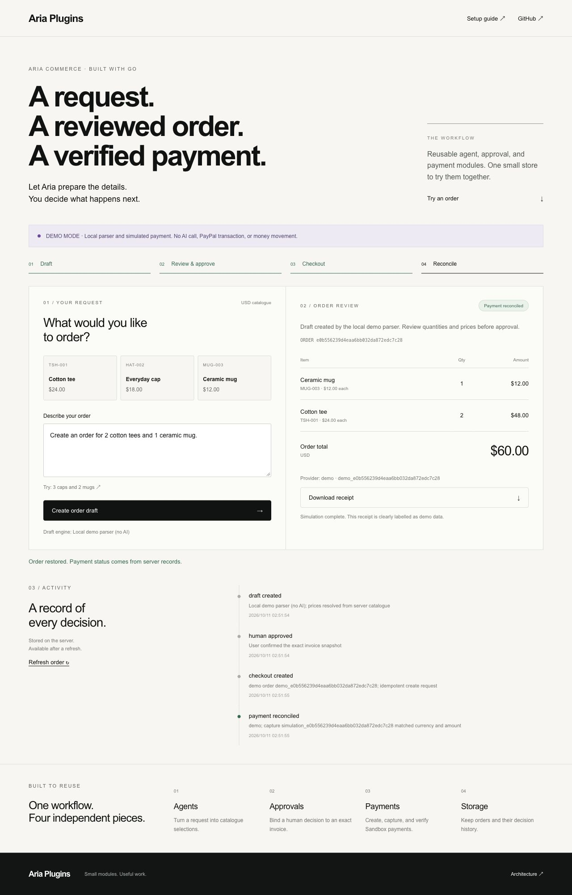

# Aria Plugins

The plugin catalogue for **Aria Code**: installable workflows, plugin metadata, and MCP tools. The layout follows the marketplace/package separation used by [Anthropic's official plugins](https://github.com/anthropics/claude-plugins-official).

**Commerce** is the first plugin. Its Go service turns a natural-language request into a catalogue order draft. The user reviews its exact contents in the browser, and a PayPal Sandbox capture is reconciled before the order is marked paid. The **Aria Commerce · Plugin Demo** webpage is an interactive example of the plugin's tools, with a browser workflow and a **Use in Aria Code** setup entry.

**Finance** connects to the independent [Financial Service](https://github.com/artheras/financial-service) for statements, SEC evidence, risk metrics, historical data and simulated backtests. Its financial algorithms live in that service, not this catalogue. See [Finance setup](plugins/finance/README.md).

## How PayPal and AI are used

**PayPal (Sandbox).** The server talks to PayPal's REST API directly (there is no Go SDK): Orders v2 to create and capture an order, `verify-webhook-signature` to authenticate webhooks, and the Reporting API (Transaction Search, Balances) in a separate **read-only** client that cannot move money. In the browser the PayPal JavaScript buttons collect the buyer's approval, but the server alone creates, captures and checks every order against the approved invoice (amount, currency, invoice ID); a webhook reconciles independently and a replay is a no-op.

**AI.** A model turns a natural-language request ("two tees and a mug", or the same in Chinese) into catalogue selections. In Sandbox mode that is Gemini on **Google Vertex AI**, called as the service's own Google identity (`ARIA_AI=vertex`); locally it can use your signed-in Aria Code account (`ARIA_AI=aria`). The model only *proposes* items. Prices come from a trusted catalogue, unknown SKUs and unknown fields are rejected, and approval, checkout, capture and refund are **not available to the agent at all**: they need a human browser session. The same tools are exposed over MCP, so an agent such as Aria Code can draft orders for a person to review.

Try it: the hosted Sandbox service is described in [docs/sandbox-deployment.md](docs/sandbox-deployment.md); locally, `scripts/run-sandbox-local.sh` runs it against your own Sandbox credentials.

## Connect to Aria Code

Inside a current Aria Code session:

```text
/skills add artheras/aria-plugins
/skills doctor
```

Then request, for example:

```text
$commerce:commerce Draft an order for 2 tees and 1 mug.
```

The current Aria installer discovers root `skills/*/SKILL.md`, reads `.claude-plugin/marketplace.json`, and verifies `skills.lock.json`. The directory name is required by the existing Aria loader; it is a compatibility format.

**One command** installs the verified Commerce MCP tools and registers them with Aria Code (macOS and Linux; no Go needed):

```sh
curl -fsSL https://raw.githubusercontent.com/artheras/aria-plugins/main/install.sh | sh
```

It checks the download against the release `SHA256SUMS`, backs up an existing `mcp_servers.json`, keeps your other servers, and runs `doctor`. Windows: use the zip from the releases page and [the bundle guide](docs/bundle-readme.md).

Skill installation alone does not register commands/MCP or build binaries. Configure and run the Go bridge using the [Aria Code connection guide](docs/aria-code.md). A full plugin manager that installs every component together belongs in the Aria Code host.

## Catalogue layout

```text
.claude-plugin/
  marketplace.json          # Plugin catalogue read by Aria Code
  skills.lock.json          # Generated Aria skill integrity hashes
plugins/
  commerce/
    .aria-plugin/plugin.json
    .claude-plugin/plugin.json
    skills/commerce/         # Canonical workflow and policy
    commands/commerce.md
    mcp.json                # Aria configuration template
    .mcp.json               # Claude-format MCP configuration
    README.md
skills/commerce/             # Generated mirror for the current Aria installer
packages/                   # Reusable Go libraries and catalogue validator
cmd/                        # Go service, MCP bridge and catalogue tooling
apps/commerce/              # Browser example
```

Edit skills inside their plugin, then run `make catalog-sync`. Commit the generated mirror and lock together. `make catalog-check` and CI reject changed hashes, stale mirrors, invalid paths, and inconsistent plugin versions. See [CONTRIBUTING.md](CONTRIBUTING.md) to add another plugin. Only implemented plugins are listed.

## Try locally

Go 1.26 or newer. Google's official Go SDK provides Firestore persistence and optional Cloud Run identity tokens.

```sh
git clone https://github.com/artheras/aria-plugins.git
cd aria-plugins
make build
./bin/aria-commerce
```

Open http://127.0.0.1:4180 and create an order for **2 tees and 1 mug**. Review the $60.00 invoice, approve it, create checkout, simulate payment, and download the labelled receipt. Refreshing preserves the server's order record.

Default demo mode uses a small deterministic parser and simulated payment. It makes no AI or PayPal calls and moves no money. Sandbox mode never silently falls back to demo.



## Repository

| Path | Role |
| --- | --- |
| apps/commerce | HTTP workflow and embedded HTML/CSS/JavaScript interface |
| cmd/server | Go service entrypoint |
| cmd/commerce-worker | Bounded recovery job for persisted payment intents |
| packages/commerce | Transport-independent order workflow and recovery |
| packages/limits | Shared atomic request quotas |
| cmd/commerce-mcp | Go MCP stdio adapter: catalogue, draft, status |
| packages/sdk | Shared invoice, catalogue, payment, and audit contracts |
| packages/agents | Demo parser and AI Gateway HTTP adapter |
| packages/approvals | Exact-invoice approval digest and expiry |
| packages/payments | Provider interface, demo provider, PayPal Sandbox implementation |
| packages/store | Atomic file, Redis REST and Firestore compare-and-swap |
| plugins/commerce | Installable workflow, host manifests and MCP configuration |
| skills / .claude-plugin | Aria-compatible catalogue discovery and integrity |
| packages/catalog / cmd/catalog | Go catalogue validation and mirror generation |
| examples | Aria MCP configuration |
| docs | Setup, architecture, validation, and submission draft |

Plugin names such as `commerce` are stable identifiers; change `displayName` for branding. New Go or Rust tools can implement the same MCP contracts without changing the catalogue's workflow format.

## Configure and validate

- [Google Cloud Run service and recovery job](docs/cloud-run.md)
- [Setup: PayPal, AI Gateway, MCP, Docker, Vercel](docs/setup.md)
- [Commerce quickstart](docs/quickstart.md)
- [Connect to Aria Code](docs/aria-code.md)
- [Architecture and HTTP contract](docs/architecture.md)
- [Validation and remaining live checks](docs/testing.md)

```sh
make test
```

This starter supports one merchant and a fixed USD catalogue. Approval, checkout, and capture require a browser session and are not exposed to MCP. Local file storage supports one server process; serverless or multiple instances must use Firestore or Redis. Cloud Run defaults to Firestore. Licensed under the [Apache License 2.0](LICENSE).

**Verification limits:** the credential-free demo and mock providers are tested locally. Real AI Gateway calls, PayPal Sandbox transactions, webhook delivery, a full interactive Aria/Claude agent session, and full provider failure recovery still require configuration and live validation. The separately deployed public Demo is simulated; its deployed image/version is recorded independently. The Aria Code marketing site is a separate project.


## Commerce 0.4.0

Stable merchant identity, owner-scoped history/search, trusted product management, invoice revision with renewed approval, unstarted-order cancellation/expiry, manual recovery review and verified full refunds are implemented. Monetary actions remain in the browser. Unknown refunds are inspected, never automatically repeated.

- [Versioned tool installation and MCP configuration](docs/bundle-readme.md)
- [Stable ownership and credential migration](docs/identity-migration.md)
- [HTTP/OpenAPI contract](contracts/commerce.openapi.json) and [plugin package schema](contracts/plugin-package.schema.json)
- [Real AI/PayPal Sandbox validation](docs/sandbox-validation.md)
- [Monitoring, backups and operational limits](docs/operations.md)

Release CI publishes six macOS/Linux/Windows platform bundles and `SHA256SUMS` when the source version changes on main. `make release` builds the same bundles locally. Only Commerce is currently an installable plugin; agents, approvals and payments are reusable libraries.
