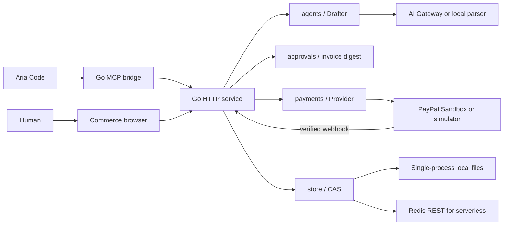

# Architecture



## Contract and reuse

Shared Go contracts live in packages/sdk. Drafter, Provider, and Store are independent interfaces. The Commerce application composes them; providers do not depend on the UI. A future service can reuse those packages through Go imports, or access Commerce through HTTP/MCP from Rust or another language.

The Aria package contains declarative commands and skills. It uses the same external Go MCP process as any compatible client; this repository does not change Aria's plugin loader.

## State and authority

```text
draft → approved → awaiting_payment → paid
```

The drafter selects catalogue SKU/quantity pairs. BuildInvoice resolves server-owned prices, combines duplicate SKUs, rejects invalid quantities and amounts, sorts items, and computes integer USD cents. A SHA-256 digest covers invoice ID, line details, currency, and total. The user's review digest must match before approval.

Checkout creation requires approval no older than 30 minutes. Once checkout exists, a later capture still requires the same immutable approved digest. The app verifies PayPal order identity and the completed capture's currency and exact amount. A browser redirect, pending capture, or client-provided success flag cannot mark an order paid.

Create/capture request IDs are stable per local order. On a capture retry, the service first checks the remote order; an already completed matching capture is reconciled without another capture request. CAS prevents two writers from silently overwriting an order. If a network or storage failure follows an external operation, retry the same order to reconcile it; do not create a replacement order blindly.

Audit records are durable operational history, not a tamper-proof ledger. Administrators with storage access can change them.

## HTTP routes

All amounts are integer cents in JSON. No endpoint accepts a client price.

| Method/path | Body / behavior |
| --- | --- |
| GET /healthz | Health and mode, no credentials |
| GET /api/config | Public mode and module information |
| GET /api/catalog | Trusted sample catalogue |
| GET /api/session | Session status and CSRF value; creates demo browser session |
| POST /api/login | {token}; connect merchant browser session |
| POST /api/orders | {prompt}; produce unapproved draft |
| GET /api/orders/{id} | Read a session/merchant-owned order |
| POST /api/orders/{id}/approve | {digest}; browser-only approval |
| POST /api/orders/{id}/checkout | {}; browser-only provider order creation |
| POST /api/orders/{id}/capture | {}; browser-only capture and reconciliation |
| GET /api/orders/{id}/receipt | Download labelled JSON receipt after reconciliation |
| POST /api/paypal/webhook | PayPal signature verification and provider reconciliation |

Browser writes require a signed HttpOnly, SameSite cookie, session CSRF value, and the exact configured Origin. Sandbox cookies are tied to the configured merchant identity. Order reads require ownership. A merchant bearer token can draft/read through MCP, but it cannot invoke approve/checkout/capture.

The browser renders model text with textContent. The service has request-size/time limits, CSP, and no permissive CORS. PayPal credentials and AI keys remain server-side.

## Limits

One merchant, one currency, a fixed catalogue, at most 100 units per SKU, and a USD 10,000 order limit. No inventory reservation, shipping, tax, fulfilment, refunds, subscriptions, multi-tenant administration, or live PayPal processing. Paid means a matched completed capture at reconciliation time; subsequent refunds/reversals are not handled in this starter.

The public demo uses anonymous per-browser sessions and local parsing. Sandbox requires merchant authentication, preventing anonymous AI usage. Merchant-token brute-force throttling, managed login, monitoring, backups, and lifecycle handling are future production work.

File persistence is atomic within one process, with fsync/rename. Redis CAS supports multiple instances. A signed cookie expires after 24 hours; losing the anonymous demo cookie loses access to that session's orders.
