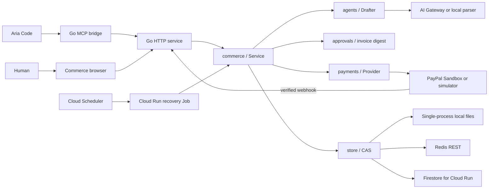

# Architecture



## Contract and reuse

Shared Go contracts live in packages/sdk. Drafter, Provider, and Store are independent interfaces. `packages/commerce.Service` composes them; HTTP handlers and the bounded worker invoke the same workflow. Authentication and CSRF remain in the HTTP transport. A trusted Actor identifies the owner and whether the invocation carries human confirmation. The Commerce application composes the adapters; providers do not depend on the UI. A future service can reuse those packages through Go imports, or access Commerce through HTTP/MCP from Rust or another language.

The repository distributes plugins through a root marketplace catalogue. Each plugins/<name> package contains metadata, workflows, and host-specific MCP configuration. The canonical plugin skills are mirrored to root skills/ for the current Aria installer; packages/catalog generates and verifies their integrity locks.

Aria's existing /skills add installs verified workflows. MCP registration and executable setup remain separate. The command Markdown is supplied for hosts that load plugin commands; the current skills installer does not register it. This repository does not change Aria's host loader. A future full plugin manager belongs in aria-code, while Go or Rust MCP tools remain independently reusable.

## State and authority

```text
draft → approved → awaiting_payment → paid
```

The drafter selects catalogue SKU/quantity pairs. BuildInvoice resolves server-owned prices, combines duplicate SKUs, rejects invalid quantities and amounts, sorts items, and computes integer USD cents. A SHA-256 digest covers invoice ID, line details, currency, and total. The user's review digest must match before approval.

Checkout creation requires approval no older than 30 minutes. Once checkout exists, a later capture still requires the same immutable approved digest. The app verifies PayPal order identity and the completed capture's currency and exact amount. A browser redirect, pending capture, or client-provided success flag cannot mark an order paid.

Create/capture request IDs are stable per local order. On a capture retry, the service first checks the remote order; an already completed matching capture is reconciled without another capture request. CAS prevents two writers from silently overwriting an order. If a network or storage failure follows an external operation, retry the same order to reconcile it; do not create a replacement order blindly.

Audit records are durable operational history, not a tamper-proof ledger. Administrators with storage access can change them.

## HTTP routes

All amounts are integer cents in JSON. No endpoint accepts a client price.

| Method/path | Body / behavior |
| --- | --- |
| GET /healthz | Health and mode, no credentials |
| GET /api/config | Public mode and module information |
| GET /api/catalog | Trusted sample catalogue |
| GET /api/session | Session status and CSRF value; creates demo browser session |
| POST /api/login | {token}; connect merchant browser session |
| POST /api/orders | {prompt}; produce unapproved draft |
| GET /api/orders/{id} | Read a session/merchant-owned order |
| POST /api/orders/{id}/approve | {digest}; browser-only approval |
| POST /api/orders/{id}/checkout | {}; browser-only provider order creation |
| POST /api/orders/{id}/capture | {}; browser-only capture and reconciliation |
| GET /api/orders/{id}/receipt | Download labelled JSON receipt after reconciliation |
| POST /api/paypal/webhook | PayPal signature verification and provider reconciliation |

Browser writes require a signed HttpOnly, SameSite cookie, session CSRF value, and the exact configured Origin. Sandbox cookies are tied to the configured merchant identity. Order reads require ownership. A merchant bearer token can draft/read through MCP, but it cannot invoke approve/checkout/capture.

The browser renders model text with textContent. The service has request-size/time limits, CSP, and no permissive CORS. PayPal credentials and AI keys remain server-side.

## Limits

One merchant, one currency, a fixed catalogue, at most 100 units per SKU, and a USD 10,000 order limit. No inventory reservation, shipping, tax, fulfilment, refunds, subscriptions, multi-tenant administration, or live PayPal processing. Paid means a matched completed capture at reconciliation time; subsequent refunds/reversals are not handled in this starter.

The public demo uses anonymous per-browser sessions and local parsing. Sandbox requires merchant authentication, preventing anonymous AI usage. Shared login/draft/payment-action throttling and structured request logs are implemented. Managed login, edge controls, cloud alert configuration, backups, and full order/refund lifecycle handling remain production work.

File persistence is atomic within one process, with fsync/rename. Redis CAS supports multiple instances. A signed cookie expires after 24 hours; losing the anonymous demo cookie loses access to that session's orders.

## Durable operations and Cloud Run

Before creating or capturing a payment, a CAS update persists an operation intent in the same record as the approved invoice. Provider request IDs stay stable across attempts. After a successful external operation, a second CAS stores the result and clears the intent. A process death or failed result write leaves a recoverable intent. Workers claim due records with a two-minute lease and back off uncertain outcomes. Sandbox recovery inspects existing captures and never initiates one. Expired checkout approval requires merchant review.

Firestore stores payload bytes transactionally in a dedicated collection and quotas in its `_limits` sibling. File and Redis adapters retain their contracts and support recovery scanning. No standalone volatile queue is required for the initial bounded scan. For larger data volumes, add an indexed durable queue instead of increasing full-collection scans indefinitely.

A process health check and dependency readiness check are separate. Server-generated request IDs connect structured HTTP logs with operation failures. The HTTP error contract is backward compatible and adds stable codes and retry metadata. Shared quotas are CAS-backed and fail closed. See [Cloud Run operations](cloud-run.md) for deployment and verification limits.
