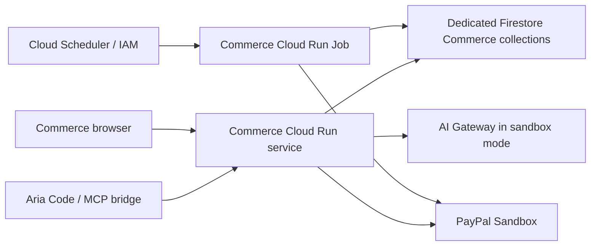

# Google Cloud Run deployment

Commerce is an independent Go plugin service and recovery job. Aria Code remains the host and relay. The existing Aria relay deployment, machine tokens, Feishu bindings, and `relay_*` Firestore collections are not modified by this repository.

The integration was checked against Aria Code's [Cloud Build configuration](https://github.com/artheras/aria-code/blob/main/cloudbuild.yaml), [Go candidate configuration](https://github.com/artheras/aria-code/blob/main/cloudbuild.go.yaml), [relay persistence](https://github.com/artheras/aria-code/blob/main/src/aria_code/relay_store.py), and [architecture](https://github.com/artheras/aria-code/blob/main/docs/architecture.md). Those files describe a production relay in `arthera-prod/europe-west2`, a Firestore option, and a separate Go candidate deployment. This is source inspection, not a verification of the currently running Google Cloud revision or its environment.

## Topology



The HTTP adapter and worker share `packages/commerce.Service`. Aria's existing relay is not a general Commerce API or payment credential issuer. Its machine token is not a Commerce merchant token. Aria's model can invoke the Commerce skill and tools; the Commerce Sandbox drafter separately uses its configured Gateway provider. A Vertex AI drafting adapter is not implemented here.

## Persistent storage and identity

Cloud Run services (`K_SERVICE`) and jobs (`CLOUD_RUN_JOB`) default to `ARIA_STORE=firestore`. Local file storage is rejected on Cloud Run, including an explicit `ARIA_STORE=file`. Redis remains an alternative adapter. Do not use a container filesystem for orders or worker intents.

Set `GOOGLE_CLOUD_PROJECT` explicitly, `ARIA_FIRESTORE_DATABASE` to your database ID, and `ARIA_FIRESTORE_COLLECTION=aria_commerce_records`. The dedicated order collection stores the invoice and payment intent in one transactionally replaced document. Shared quota records live in `aria_commerce_records_limits`. Collection names beginning with `relay_` are rejected. A dedicated database/project can provide stronger IAM isolation; collection naming alone is not an IAM boundary.

The official Google Firestore SDK uses Application Default Credentials. On Cloud Run, attach an appropriate service account; no downloaded service-account key file is needed. Give it only the database and Secret Manager access needed for Commerce. Browser/model credentials are not forwarded to Firestore or PayPal. ADC credentials never come from browser input.

## Build and stage the service

`Dockerfile` builds both `/usr/local/bin/aria-commerce` and `/usr/local/bin/aria-commerce-worker`. `cloudbuild.yaml` only builds and pushes an immutable commit-tagged image. It does not change relay deployment or production traffic.

Configure the Cloud Build trigger's `_IMAGE` substitution to the Commerce image path in your Artifact Registry repository. For a manual build, supply an immutable source identifier as `COMMIT_SHA`:

```sh
gcloud builds submit --config=cloudbuild.yaml \
  --substitutions=_IMAGE=YOUR_REGION-docker.pkg.dev/YOUR_PROJECT/YOUR_REPOSITORY/aria-commerce,COMMIT_SHA=YOUR_COMMIT_SHA
```

Copy the non-secret [service environment template](../deploy/cloud-run/service.env.yaml), replacing its project and exact browser origin. Set a stable `ARIA_SESSION_SECRET` through Secret Manager. For Sandbox, also configure a separate agent merchant token (`ARIA_MERCHANT_TOKEN`), a different human login secret (`ARIA_MERCHANT_LOGIN_TOKEN`), PayPal Sandbox credentials, and AI Gateway model/key. Start with a separate private candidate service, using its own service name and service account. Initial IAM-protected HTTP smoke checks can use an authorised Google ID token. Private Cloud Run browser access needs an authenticated front door; a direct anonymous browser cannot open it.

For an existing Commerce service, follow Aria's candidate pattern: update the image with `--no-traffic --tag=commerce-candidate`, verify it, then explicitly promote. Candidate URLs need the matching `PUBLIC_URL`; cookies, Origin checks, and payment return URLs must all use that origin. Do not use Commerce settings on the relay service.

Public credential-free demonstration access is a separate intentional release decision. Sandbox still requires a merchant session. The repository does not create a public service or change any IAM bindings automatically.

## Run recovery as a Cloud Run Job

Recovery is a bounded job, not an in-process HTTP timer. Cloud Run can suspend or terminate HTTP instances between requests. The order document carries durable recovery intent, attempts, due time, and a manual-review marker.

Use the same image and dedicated Firestore namespace as the service. Copy [worker.env.yaml](../deploy/cloud-run/worker.env.yaml). For Sandbox, supply the PayPal client ID/secret. The job does not need an AI key, merchant token, or browser session secret.

```sh
gcloud run jobs create aria-commerce-reconcile \
  --image=YOUR_COMMERCE_IMAGE_WITH_COMMIT_TAG \
  --region=YOUR_REGION \
  --service-account=YOUR_COMMERCE_WORKER_SERVICE_ACCOUNT \
  --command=/usr/local/bin/aria-commerce-worker \
  --args=--batch=100,--pages=100,--timeout=8m \
  --env-vars-file=YOUR_WORKER_ENV_FILE \
  --tasks=1 --parallelism=1 --task-timeout=600s --max-retries=1
```

Create a Cloud Scheduler HTTP target for:

```text
POST https://run.googleapis.com/v2/projects/YOUR_PROJECT/locations/YOUR_REGION/jobs/aria-commerce-reconcile:run
```

Authenticate the Scheduler request with an OAuth service-account token for the Google API, not an OIDC token for a Commerce HTTP route. The Scheduler service account needs permission to execute that specific job; the worker's execution identity is separate. A one-minute schedule is a starting point. See [Google's job scheduling guide](https://cloud.google.com/run/docs/execute/jobs-on-schedule).

The job processes paginated records, claims an intent through CAS, and uses exponential backoff on uncertain results. A Sandbox recovery never initiates capture: it inspects an existing provider order and reconciles a completed matching payment. If the provider still reports an unpaid CREATED/APPROVED order, it releases that capture intent for another explicit browser action. Checkout retries retain the same provider request ID and require unexpired exact-invoice approval. Expired or invalid operations are marked for merchant review.

The scan is bounded to 100 pages by default. A limit hit exits nonzero rather than claiming a complete scan. Increase the bound or move to an indexed durable work queue before data volume exceeds it. Repeated/overlapping executions are safe through CAS, stable provider request IDs, and duplicate reconciliation checks. Do not run two processes against local file storage; Cloud Run jobs require shared persistent storage.

## Private Cloud Run MCP calls

Set `ARIA_COMMERCE_URL` to the service/candidate origin and a separate `ARIA_MERCHANT_TOKEN`. Never give the bridge `ARIA_MERCHANT_LOGIN_TOKEN`; that secret is only for the human merchant's browser login. For an IAM-protected service, also set `ARIA_CLOUD_RUN_AUDIENCE` to the canonical Cloud Run service URL and configure ADC using an identity authorised to invoke that service. The Go SDK refreshes ID tokens.

The bridge sends the Google ID token in `X-Serverless-Authorization`, while `Authorization` carries the Commerce merchant credential. These credentials have distinct purposes. Do not reuse Aria relay machine tokens or Google credentials as merchant tokens. A user ADC login alone is not guaranteed to support ID-token minting; use an appropriate service account or supported impersonation configuration. See [Cloud Run service authentication](https://cloud.google.com/run/docs/authenticating/service-to-service).

The MCP surface remains catalogue, draft, and order status. Human approval, checkout, and capture remain browser-only.

## Operations and limits

`/api/health` is process liveness. `/api/ready` checks shared quota storage read/write access with a short timeout; it does not call AI or PayPal. JSON request logs include server-generated `request_id`, matched route, method, status, and duration. Payment failure logs add order and operation IDs. Logs omit prompts, headers, credentials, request bodies, and URL queries.

Shared limits default to 10 drafts per owner/minute, 120 globally/minute, 500 globally/UTC day, and 50 per owner/UTC day. Invalid or failed draft attempts consume capacity conservatively. These count requests, not billed tokens or currency. Payment actions are capped at 30 per owner/minute. Login attempts are limited by the direct network peer; forwarded headers are not trusted. Behind Cloud Run's proxy this may group clients, so also configure an authenticated front door or edge rate controls appropriate to your ingress topology before public merchant use.

Quota storage failure rejects the request before an external draft call. `429` includes `Retry-After`. Errors preserve the existing `error` string and add `code`, `retryable`, and `request_id`.

Create Cloud Logging alerts for recovery failures, scan-limit hits, repeated provider errors, and sustained 429/503 responses. Configure database backups/retention. No live Cloud Run, Firestore, IAM, Scheduler, AI, or PayPal changes were executed by this implementation. Local protocol fakes and failure tests do not prove live configuration.

## Demo deployment snapshot — 2026-10-11

The independent `aria-commerce` Demo is deployed in `arthera-prod/europe-west2`. It uses the dedicated `aria-commerce` Firestore database, a database-scoped runtime IAM condition, and a Secret Manager session secret. Public invocation was explicitly approved. The existing Aria relay was not updated.

The `aria-commerce-reconcile` Job uses 512 MiB memory and has completed successfully. Cloud Scheduler invokes it every five minutes using a dedicated OAuth service account with invoker permission on that job. The live simulated order flow passed session creation, USD 60.00 drafting, approval, checkout, capture, receipt and duplicate-capture checks. Invalid CSRF and capture before approval were rejected. These checks use the demo parser and simulated payments; they do not validate real AI, PayPal credentials, webhooks, or recovery of an actual provider failure.

Use `/api/health` and `/api/ready` on Cloud Run: the platform reserves some paths ending in `z`, including the previously used liveness path. See [Cloud Run reserved URL paths](https://docs.cloud.google.com/run/docs/known-issues#reserved-url-paths).
